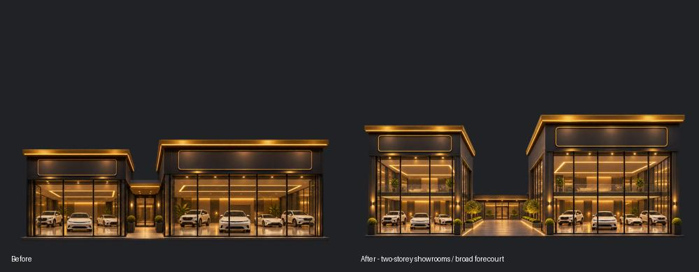
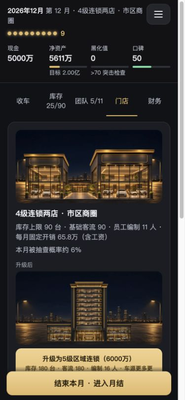

# v1.1.1 全面审计修复验收

对应 [修复前审计报告](审计-2026-11-10.md)。项目为 `Lynch715/guapi-ershouche`，从提交 `0bd1765aec060639c8a640d671f2147336a227d1` 开始修复。本轮完成报告列出的 4 项优先修复、7 项常规修复和 6 项打磨建议。交付版本 **v1.1.1**，资源缓存号 **20261110.4**，发布分支为 `main`。

## 修复对应表

| 审计项 | 已实现的行为 | 验证 |
|---|---|---|
| A11 事件天价成交 | 砍价、介绍客户、置换、车队采购、阴阳合同统一受车况及预算约束；额外费用按实际成交价计算；收藏家保留明确的 25% 溢价；确认前显示受约束报价。 | 覆盖 10 个事件选项路径及原始种子 1008，自然抽卡后实际成交 93,261 元，不再以 1.8 亿成交或触发通关。 |
| A01 重复退车与坏档 | 每笔销售只可退款一次，按销售 ID 结清其余投诉和隐患；不会误删下一个无关待办。同一辆车再次卖出后有新的售后生命周期。 | 重复投诉、再次转售退款、存档往返及旧版重复库存恢复通过。 |
| A07 文件脚本注入 | 导入成交记录按字段白名单重建，美术由渲染器生成；车名、费用分类和选项文字统一转义。补充事件附带车辆、应聘者的资料校验，头像性别路径只允许 m/f。 | 危险图片事件与标签均未执行或生成节点，字面文本保留；额外渲染字段被移除，事件嵌套绕过被拒绝。 |
| A02 漏判查封 | 黑化达到 100 即锁定查封，月底自然回落不撤销，终局不能继续处理待办。 | 历史、结算和实际终局一致，黑化保留 100。 |
| A03 事件降价失效 | 选择同行事件降价后停止自动定价；正在洽谈的买家重新核价。玩家可在库存恢复自动定价。 | 刷新估价后折后价保留，恢复按钮有效。 |
| A04 成交漏入月结 | 事件、主动议价、月底零售、同行批发、银行拍卖、资金紧张甩卖共用本月交易台账；月结分零售、批发与处置展示。 | 事件零售与同行批发各记录一次，收入对账通过，新月份不重复。 |
| A06 退车残留义务 | 清理关联质保、民间担保及可识别的断供明细；完整检测退回车辆，移除旧买家洽谈。旧版没有销售 ID 的担保只在名称与原始金额唯一匹配时关联。 | 退车后不再留下原销售质保与担保；两种隐患均已知，另一位买家的断供保留。 |
| A10 摆平费用重复记账 | 摆平费作为当期费用，车辆成本只保留抵押本金。 | 本金 10 万加费用 3 万，累计成本费用为 13 万。 |
| A05 招聘生效时间 | 新招聘及上门人才的工资、行动点、客流、整备折扣和罚款减免均下月生效；未上岗员工不触发在岗事件。旧档已在职员工继续有效。 | 当前月各项加成为零；次月一起生效，工资不提前扣，第一工作月不虚增已完成任期。 |
| UI01 焦点隔离 | 弹窗接管焦点、限制 Tab/Shift+Tab、背景 inert；关闭后恢复入口焦点，背景点击有额外保护；下拉框补可访问名称。 | 真实浏览器焦点、背景交互及恢复检查通过。 |
| UI02 月结保存失败 | 普通操作和月结共用保存反馈，月结有持久警告，菜单展示“尚未保存”，支持重试与导出。 | 真实注入 QuotaExceededError 后提示出现；恢复存储后重试成功。 |
| A08 结局文字 | 保留当前黑化决定结局类型的规则，改为描述经营到今天的状态，不再宣称从未卖过黑车。 | 有灰色历史的低黑化结局不再出现虚构清白文字。 |
| A09 抽查百分比 | 概率统一限制在 0–100%。 | 原 142.77% 场景现为 100%。 |
| 缩放与小字 | 恢复浏览器手势、滚轮和键盘缩放；HUD 与整备说明小字提高到 12px。 | 事件不再被取消，viewport 不含禁止缩放限制。 |
| 四级门店美术 | 双层玻璃展厅、宽中央前院、暖金屋顶；单独调整四级取景，让双店在场景中更清楚。 | 手机实页与素材对比目检；1200×900 WebP，alpha 转换一致。 |
| 画风衔接 | 车辆展示用暖色光晕，员工头像增加暖金边框，保持全局暗底与金色；电脑团队改双列卡片。 | 手机及电脑页面目检。 |
| 脏污语义 | 改为“车身/内饰脏污”，与清洗及车外泥点表现对应。 | 库存标签与实际车辆状态显示核对。 |

## 存档兼容与恢复边界

- 存档版本仍为 **1**。自动进度键 `usedcar_sim_save_v1` 和三个手动档位键均保留。
- 旧档没有 `startsMonth` 的已有员工保持在职；旧版主动议价成交会衔接进统一台账，旧记录中的 HTML 美术不再使用。
- 重复退车恢复要求相同车辆资料、退车日志和唯一匹配的销售记录同时存在；合并车辆与已知车况，保留随机数与原账面资金。无法确认的任意重复 ID 仍拒绝导入，原文件保持。
- 已经发生的多次退款不自动补回现金，避免在销售记录不完整时猜测历史资金。旧版无法唯一关联的金融义务也不凭名称批量删除。
- 通过发布前 `0bd1765` 的原引擎生成合成旧档（含库存和未完成洽谈），在应用内浏览器导入、读取、实际点击月结续玩，随后自动存档可再次解析。未使用玩家个人或线上存档。

## 测试结果

- 原有 **547 项**断言全通过：72 引擎、47 三档存档、84 交易、344 议价审计；35 张事件卡的 **266 个**选项组合通过。
- 新增 **91 项**修复回归通过，合计 **638 项**断言。入口 `node tools/test-audit-fixes.js`；原 `tools/audit-comprehensive.js` 现在转向验证修复行为，不再覆盖修复前的证据。
- **22 项**真实浏览器专项通过，涵盖存档脚本注入、焦点循环、缩放、配额故障、保存重试及旧档续玩。入口 `tools/audit-fix-browser.html`，通过新版 Codex 应用内浏览器执行。该工具限定在独立 localhost 预览端口运行，正式网站禁用验收操作。
- 真实文件选择、指定档位导入、读取、刷新续玩已走通；合成四级门店档含 25 台库存、4 位在职员工与 1 位待上岗员工，用于核对分页、上岗提示和美术。
- 经营长跑仍为三档资金 × 三个地段 × 四种策略 × 40 局，共 **1,440 局**，种子 1000–1039，最多 120 月。专业策略九组均通关，中位 **85–92 月**；常规灰色约 **73%–90%** 通关，激进灰色约 **15%–48%**。整数百分比沿用脚本四舍五入。
- 小本城郊专业策略通关率 100%，中位 86 月；激进灰色通关率从审计前 45% 变为 15%，查封从 55% 变为 85%。主要修复了漏判查封，未为贴回旧胜率而另调经营配置。样本用于回归检查，不代表真人通关保证。

开发验收使用 localhost 应用内浏览器；发布后的部署与线上文件另行核对。实体 iPhone 主屏模式、Safari/微信内核和真人听音仍未实测。

## 四级门店资产记录

使用 **imagegen 技能的内置图像编辑工具**，以原四级门店为编辑目标，生成后接入项目。没有调用 CLI 或外部模型。

- 正式运行资产：`assets/store/store_l4.webp`。
- 新 PNG 母版：`assets_original/store/store_l4.png`。
- 旧 PNG / WebP 备份：`assets_original/audit-before-20261110/store_l4.png` 与 `store_l4.webp`。
- 工具原输出：`exec-4e66d463-8f6e-45dc-951e-d384f7c71370.png`（生成目录原输出，仅本地保留）。
- 原输出保持；项目母版按比例适配到 1200×900，底部 alpha 边界对齐 864，再按现有质量 85 构建 WebP。alpha 经逐像素比对一致。
- 新资产 URL 带 `?v=20261110.4`，避免旧图缓存继续显示。

最终提示词：

> Use case: precise-object-edit. Edit target: supplied level-four used-car dealership game building asset. Improve only its architectural silhouette and layout so the upgrade reads clearly as an impressive two-branch dealership complex. Keep the established realistic illustration / game cutout style, warm gold lighting, dark charcoal facade, straight-on front elevation, and clear glass showrooms with anonymous unbranded cars. Increase the height and architectural presence of both showroom buildings (a tall double-height glazed volume, right flagship slightly larger), separate the two buildings with a visibly broad central open forecourt/courtyard (about one fifth of total scene width), and connect them only with a low unobtrusive rear passage. Both buildings should have substantial blank signboards and gold roof trim. Keep an empty upper area and the ground line at 96 percent of canvas height; preserve the 1200x900 4:3 canvas and transparent background. Show the entire complex with about 4 percent side margin. No sky or background, no people, no readable text, no logos, no watermark, no new towers. Output a single transparent production-quality building asset.

回归输出和长跑记录保存在 `_screens/audit-fix-20261110/`，沿用本地忽略规则。本文使用的截图已收录到 `docs/audit-20261110/`，浏览器回归所需合成旧档已收录到 `tools/fixtures/legacy-v1.json`；母版和原图备份仅在本地。运行 WebP、代码、测试与本文构成交付内容。
