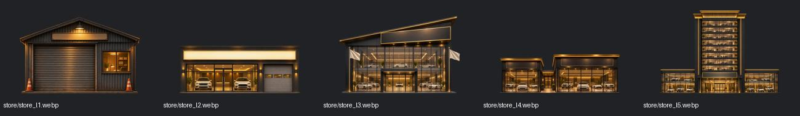
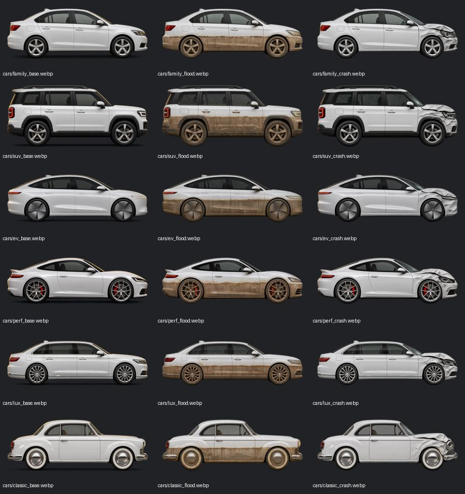

# 瓜皮二手车 v1.1 全面审计

审计日期：2026-11-10。对象：`Lynch715/guapi-ershouche`，本地独立仓库 `prototype/`，基线提交 `0bd1765aec060639c8a640d671f2147336a227d1`。本轮只做审计与复现实验，未改游戏源码、数值或美术，未提交、推送或部署。

后续状态：用户已授权按本报告修复，最新实现、验收与边界见 [v1.1.1 修复验收记录](修复验收-2026-11-10.md)。下文保留修复前审计发现。

结论：有 **4 项应优先修复的问题、7 项常规修复项、6 项文字和美术打磨建议**。最重要的是异常价格可以直接通关、退车生成重复库存导致存档不可读、导入文件可执行页面脚本，以及月结漏判查封。现有回归全部通过，不能据此判断这些组合路径没有问题。

## 验收范围与证据

- 阅读全部 15 个运行脚本、两个 CSS、入口、配置、存档与已有测试工具。
- 原有回归：72 项引擎断言、47 项存档断言、84 项交易断言、344 项交易审计断言，共 **547 项**通过；另有 **266 个事件选项组合**通过。
- 新增 `tools/audit-comprehensive.js`，11 组定向复现实验。运行：`node tools/audit-comprehensive.js`。输出 `_screens/audit-20261110/engine-findings.json`，包含独立合成存档，未读取玩家存档。
- 经营长跑：三档资金 × 三个地段 × 四种策略 × 每种 40 局，共 **1,440 局**，种子 1000–1039，单局最多 120 月。原始输出 `sim-*.txt`，摘要 `simulation-summary.json`。
- 议价配对：五种策略、买卖两侧，每种 1,000 个种子样本，见 `trade-strategies-1000.txt`。这些是局部交易实验，不是 10,000 局完整经营。
- 美术：79 张 WebP、8 个图标文件全部可解码；WebP 合计约 4.97 MiB。目检车辆 18 张、门店 5 张、头像 8 张、结局 5 张，并检查真实页面的染色车辆、车库和首图。
- 浏览器：新版 Codex 应用内浏览器，隔离的 `http://127.0.0.1:18973/`。390×844 手机端走通开局、跳过引导、看车、验车、购买、入库、接待、还价、成交、文件导入与读取、月结；1280×900 检查团队、财务与事件；320×740 专项检查财务布局。所查页面无横向溢出。未使用本机 Chrome。
- 未覆盖：实体 iPhone 主屏模式、Safari/微信内核、真人听音、全套结局在所有尺寸下的交互。没有重新审计线上部署或网络缓存，结论针对当前本地提交。

## 应优先修复的 4 项

### A11 · P1：事件客户可以按天价挂牌成交，绕过经营目标

位置：`js/events.js:169–175`，同类风险还在 `referral`、`trade_in`、`vip_fleet` 等事件的直接成交分支；`js/game.js:740`。

复现不需要修改存档或强制抽卡：种子 **1008**，小本、城郊，去个人散户买第一台车，手动挂牌 **2 亿**，月结后自然抽到「难缠的砍价客户」，选择让一成。原估值 **88,151 元**的车按 **1.8 亿**成交，第 2 月直接通关，净资产 184,904,000 元。其他种子需要等相应事件出现。

原因：事件把玩家挂牌价直接当成客户可接受价格，跳过普通零售和主动议价中的估值、意愿和预算约束。只限制输入为有限数字挡不住这个漏洞。

建议：所有事件成交共用客户估价和预算校验；事件的特殊折扣、批量采购和置换溢价在合理估值基础上计算。修复时逐个检查所有 `G.sellRetail` 调用点。证据：`natural-event-exploit-before.json`、`natural-event-exploit-result.json`。

### A01 · P1：同一销售的多项投诉可重复退车，制造坏档

位置：`js/game.js:588–594`、`728–731`、`930–944`。

一辆车有两个未披露隐患时，引擎为每个隐患保存独立车辆副本。同月两项投诉分别选择退车，会把同一车辆 ID 两次加入库存。本次得到 `[4, 4]`，随后 `G.parseSave` 拒绝读取，提示「库存车辆编号重复」。自动保存仍可把这一状态写下，刷新后可能无法续玩；手动档位保存也会拒绝。

建议：以 `saleId` 管理整笔售后生命周期，退车只允许执行一次，同时取消同笔销售剩余投诉、隐患和质保；入库前再检查车辆 ID。除防止新问题外，需要考虑对已经重复的旧档做定向恢复。证据：`duplicate-return-save.json`。

### A07 · P1：导入存档中的 HTML 会被执行

位置：`js/game.js:236–237`、`js/ui.js:444`、`460`。

`month_.negotiatedSales` 允许额外的 `art` 字符串；月结把它直接插入 `innerHTML`。费用分类 `month_.opexBy` 的键也没有转义。带事件属性的图片标签可通过存档校验、导入指定档位并读取，结束本月后执行。

已在应用内浏览器实证：仅设置 `document.documentElement.dataset.auditHtml = 'executed'` 的测试代码成功执行，费用分类中的 `<b>` 也变为真实节点。没有访问外部地址或发送任何数据。此风险需要玩家导入被构造的文件触发，不是普通车名自动生成就会发生。

影响：在正式站点中，这类代码拥有游戏页面同源权限，可读取或改写该站点自动进度和三个档位。

建议：导入后按白名单重建数据对象；持久化成交记录只保存车型、价格等数据，渲染时重新生成可信美术；所有玩家或文件可控文本统一转义。不要将导入的 SVG/HTML 当成可信美术复用。证据：`html-injection-save.json`、`html-injection-mobile.png`。

### A02 · P1：月结达到黑化 100 后先衰减，漏判查封

位置：`js/game.js:1038`、`1048`、`1061`。

黑化 95 的车行被检查出 3 处问题，历史账本记录黑化已经 **100**，但月结先自然回落到 **97**，之后才调用结局判定，`over` 仍为空。直接灰色操作达到 100 时会查封，两种入口的规则不一致。

建议：达到终局阈值时立即判定，并阻止后续衰减撤销已经触发的结果；检查月结内部所有改变黑化或终局的入口。修复后重跑灰色策略平衡，因为现有查封率可能受此缺陷影响。

## 常规修复的 7 项

| 编号 / 级别 | 确认的问题与影响 | 位置及建议 |
|---|---|---|
| A03 / P2 | 「同行低价抢客」选择降价，挂牌从 62,000 降到 59,000，但仍是自动定价；刷新报价又回到 62,000。月结在客户挑车前也会刷新，降价可能完全未用于销售。 | `js/events.js:268`、`js/game.js:45`。明确此事件降价持续期，更新定价模式或增加当月折扣，重估正在洽谈的买家。 |
| A04 / P2 | 事件中卖出的车有收入、有成本、有累计销量，却不进入月结成交清单。实验中已卖 1 台、收入 56,000，月结日志仍写「成交 0 台」，界面会说「这个月一台都没卖出去」。批发也应明确单列。 | `js/game.js:735–740`、`1028`、`1067`，`js/ui.js:445`。用统一的本月成交台账供事件、主动议价和月底零售记录，按零售/批发分组。 |
| A06 / P2 | 退车后旧质保仍存在；实验中车已回库，质保仍为 1 份，后续可能继续扣理赔。退车还强制 `inspected:true`，却只揭开本次投诉的隐患，其他未知隐患仍隐藏，深度检测按钮因此不能使用。 | `js/game.js:591–594`、`909–925`。退车时结清销售关联义务；要么真正完成全车检测，要么保留可检测状态。与 A01 一起修复。 |
| A10 / P2 | 二次抵押「私下摆平」的 3 万支出既计入当月费用，又加进车辆成本。10 万本金加 3 万摆平，车辆出售后累计确认 16 万成本费用，实际相关投入只有 13 万。利润被重复扣减。 | `js/finance.js:312–314`。选择费用化或资本化之一，避免重复；检查断赎、拆件、拍卖等资产转费用的分录。 |
| A05 / P2 | 招聘提示和帮助都说下月上岗，但当月立刻获得技师折扣、客流和罚款减免，并立即计入工资。本次新聘三级技师，任职 0 月时整备倍率已从 1 变成 0.7。行动点却要等下月刷新，生效时点混杂。 | `js/staff.js:17–21`、`88–98`，`js/ui.js:349`。统一「当月入职」或「下月生效」规则，再同步提示与工资。 |
| UI01 / P2 | 弹窗没有接管或限制键盘焦点。实测月结弹窗打开时按 Tab，焦点落到背后「存档菜单」，`insideDialog:false`。背景按钮仍可被键盘触发。库存质保下拉框也没有可访问名称。 | `js/ui.js:12–15`、`411–413`、`265`。打开时设置焦点、限制 Tab 范围、背景设 inert，关闭后恢复；为选择框补标签。 |
| UI02 / P2 | 普通操作保存失败会提示，但月结专用分支直接调用 `G.save()` 后忽略返回值；如果玩家只连续结束月份，写入失败可能一直没有提示。 | `js/ui.js:614`，对比 `543`。共用保存反馈入口，并在菜单显示当前进度是否已成功落盘。此项已由源码确认，未在本轮浏览器中注入容量失败。 |

## 文字、美术与体验的 6 项打磨建议

以下包含设计判断，不应与前述数据和程序错误混为一谈。

1. **良心结局文案与历史不符（A08，P3）**：当前只按通关时黑化是否低于 30 判定。即使已有 100 次灰色操作，只要黑化降到 29，也会显示「你没靠一台黑车」。可以保留洗白玩法，但改成反映转变的结局文案；若希望评价整个生涯，应使用累计历史和售后记录，而非只看当前值。位置 `js/game.js:106`、`js/data.js:219`。
2. **抽查概率可显示为 143%（A09，P3）**：大规模、高黑化、近期隐瞒台账较多时，`G.inspectChance()` 返回 1.4277。实际随机判定已经必查，但门店仍直接显示百分比。建议统一封顶 100%，极高风险用文字说明。位置 `js/game.js:48–56`、`js/ui.js:302`。
3. **小字与缩放（P3）**：HUD 有 10–11px 字体、整备说明有 11px，页面同时通过 viewport 和全局手势、滚轮、键盘处理禁止缩放。建议允许用户缩放，并增大关键信息。位置 `index.html:5`、`js/mobile.js:5–14`、`css/style.css:94–95`。这对视力较弱玩家的影响高于装饰性字体调整。
4. **四级门店升级感偏弱（美术建议）**：三级是高挑大展厅，四级虽然有双店，但每栋较矮、中央广场窄，缩小后容易觉得建筑降级。建议拉开两店间距，增强分店关系、入口和招牌辨识度；保留双店设计。素材 `assets/store/store_l4.webp`。
5. **画风统一（美术建议）**：首图是夸张喜剧角色，车辆和建筑较写实，头像是平涂插画。单张都可用，但进入经营后主视觉的幽默感减弱。建议以色温、轮廓和少量角色表情渐进统一，不需要整套重画。
6. **内饰脏污却显示车外泥点（语义与美术建议）**：`dirty` 的玩家文案为「内饰脏污」，车辆渲染却叠加外车身泥点，`清洗抛光` 只修复这个状态。建议把状态改成更准确的「车身/内饰脏污」，或分别使用内饰提示与外观泥点。位置 `js/data.js:163`、`js/art.js:206`。避免让玩家从图上误判为泡水证据。

美术目检还看到灰色通关图中的钞票更像纸捆、电脑团队页单卡较宽且留白多，可在后续常规打磨时调整，不列为阻断项。未见本轮目检范围内明显文字乱码、车辆断轮、图像缺边或损坏文件。

## 平衡结果及其边界

三档和三个地段中，老实专业策略样本都通关，中位 85–91 月。九组常规灰色策略通关率约 78%–93%，激进灰色策略约 38%–78%；原脚本按整数四舍五入显示比例。模拟新手策略约 50%–68%。所有组的破产均为 0%，不代表真人不会破产，因为机器人有固定的收车、留现金和事件处理策略。

小本城郊专业/谨慎灰色/激进灰色/新手的通关率分别为 100%/87.5%/45%/50%，专业和谨慎灰色的通关中位月数为 86/69。保守收车议价有约 3.2% 卖家离场率，连续狠砍约 79.7%；卖车连续坚持原价约 64.8% 买家离场，确有明显策略差异。

这些结果支持「常规经营轨迹可跑通」，不能支持「平衡已全面健康」。A11 的事件成交漏洞根本未被机器人尝试；A02 修复后灰色策略查封率可能变化。建议先修正确性，再重新校准数值，不要现在根据这批样本直接加强或削弱某条路线。

## 修复顺序与验收建议

1. 先修事件成交约束、售后销售生命周期、存档渲染边界、查封顺序。这四项优先于增加新玩法或重画整套素材。
2. 修统一成交台账、价格状态和会计重复记账，再统一员工生效时点、月结保存失败提示与弹窗焦点。
3. 最后同步文案、美术表现和可读性；重跑 547 项既有断言，把本轮复现转成「修复后必须通过」的回归，再做灰色策略长跑和实际旧档导入续玩。

新增审计脚本当前用于记录基线缺陷，其中自然事件复现依赖固定种子；修复后应调整为验证正确行为的测试，不能把当前缺陷输出当作通过标准。

附：截图、复现 JSON、联系表和长跑原始记录均位于 `_screens/audit-20261110/`，该目录沿用仓库忽略规则，仅本地保留。门店与车辆对比图另收录到 `docs/audit-20261110/`，随本报告和复现脚本交付。
